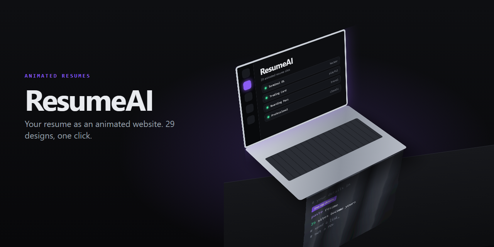
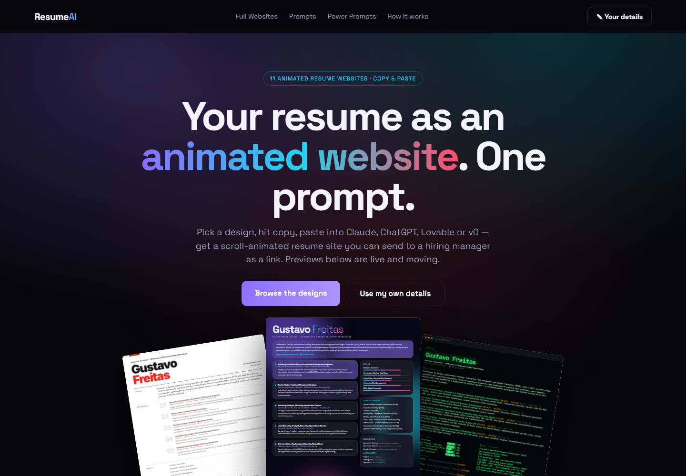

[](https://tootenramen.github.io/ResumeAI/)

# ResumeAI

**Your resume as an animated website. One prompt.**

29 finished, animated resume websites and a library of copy-paste AI prompts. Pick a design, click **Use my
details**, paste your resume, and every site becomes yours. Open or download one and host it free to send hiring
managers a link instead of a PDF.

**Live demo:** https://tootenramen.github.io/ResumeAI/



## What's inside

| Path | What it is |
|---|---|
| `index.html` | the gallery: browse every design, personalize with your details |
| `sites/` | the 29 finished resume websites, each one standalone `.html` file |
| `sites-bundle.js` | all 29 sites packed for the gallery (rebuild with `source-and-tools/build-bundle.ps1`) |
| `ALL-PROMPTS.txt` | every prompt as plain text: a details extractor, 11 website-building prompts, 8 power prompts |

## Use it

1. Open `index.html` in any browser. No install, no build step.
2. Click **Use my details**, paste your info, and every design updates.
3. **Open** or **Download** a design, then drag the `.html` onto [Netlify Drop](https://app.netlify.com/drop) for a free link.

The sample resume in the demo is the author's. The contact details are placeholders (`gustavo@example.com`,
`555-010-0100`); replace them with your own.

## Rebuild the bundle

Only needed if you edit files in `sites/`:

```
powershell -ExecutionPolicy Bypass -File source-and-tools\build-bundle.ps1
```

---
Built by [Gustavo Freitas](https://github.com/Tootenramen) - [LinkedIn](https://www.linkedin.com/in/gustavo-freitas-69b93910b/) - [more projects](https://tootenramen.github.io)
